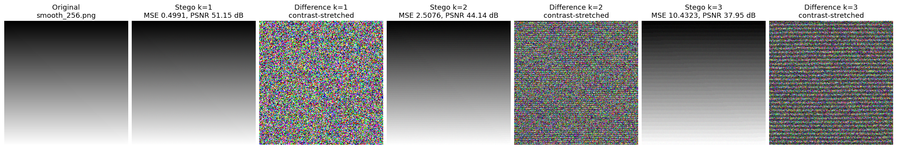
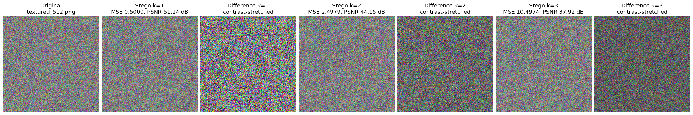
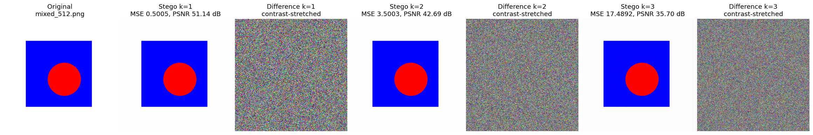
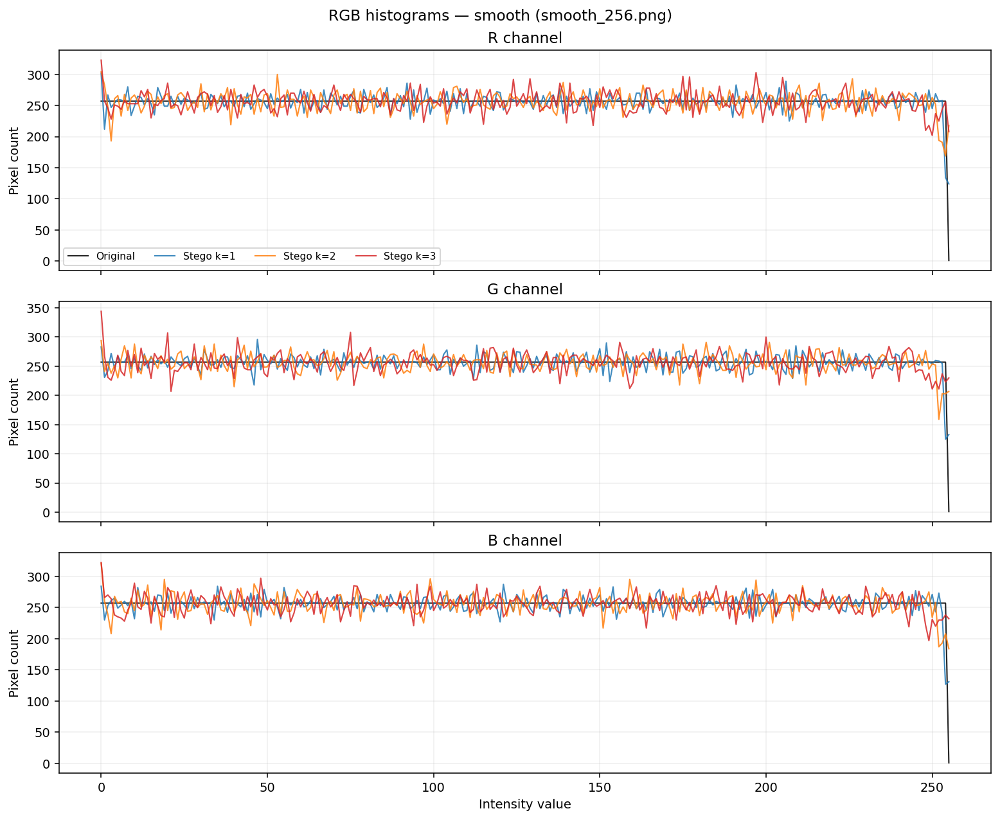
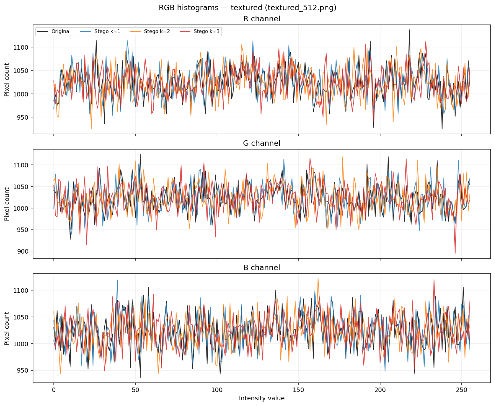
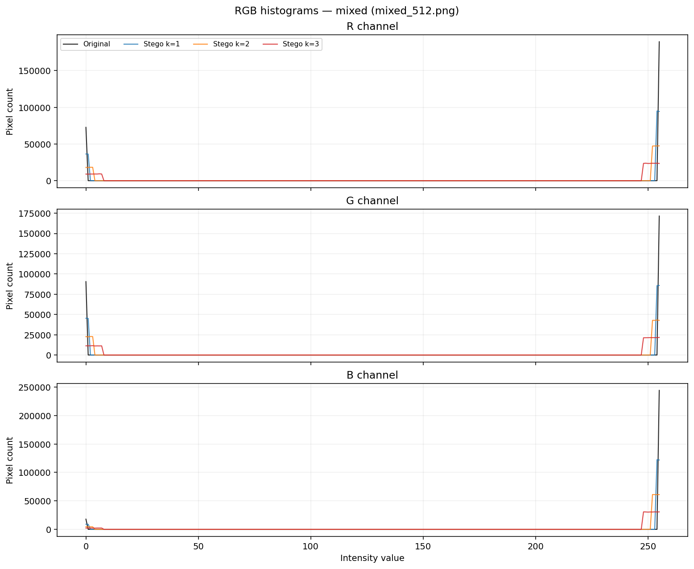
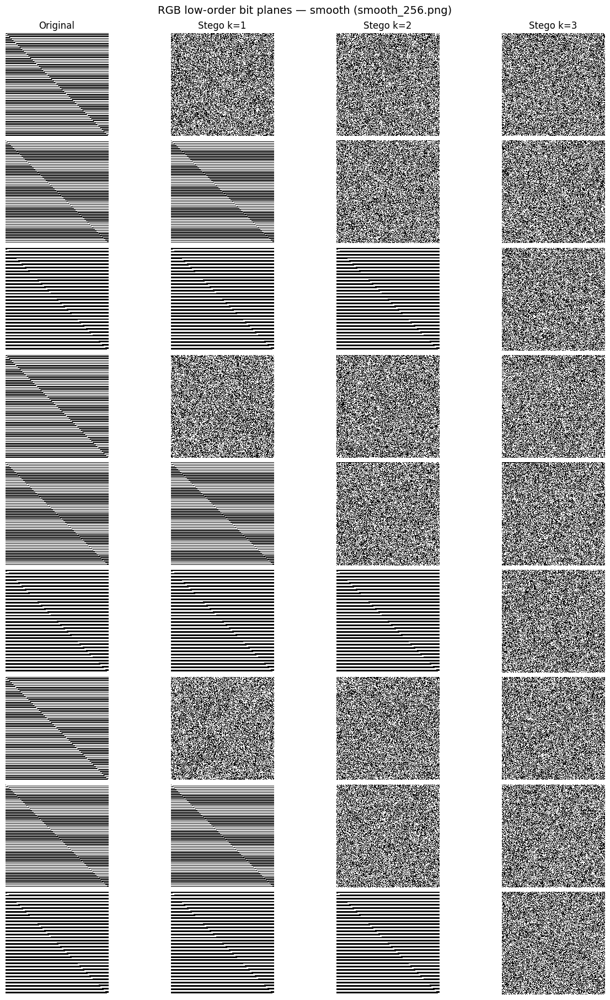
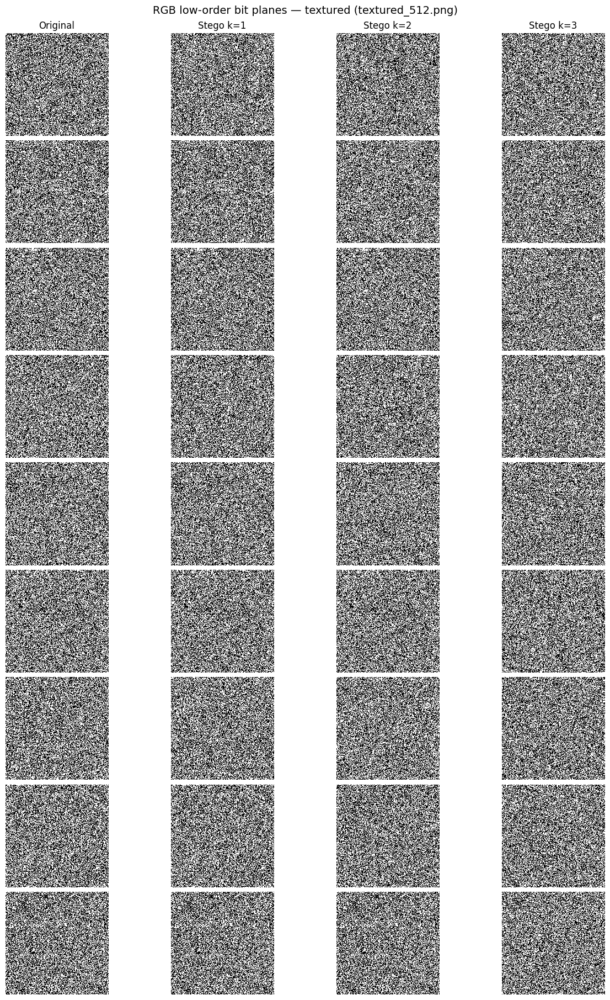
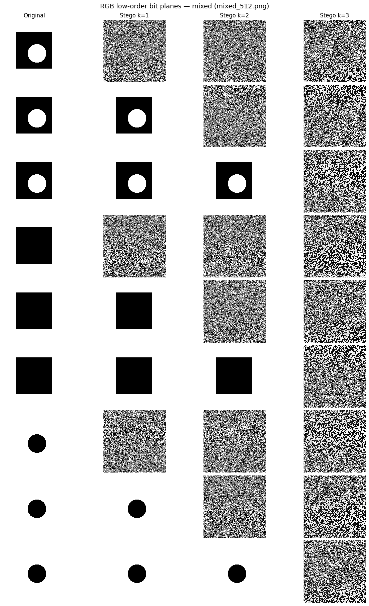

# Experiment Matrix Results

## Coverage check

The existing samples cover all requested image classes and at least two
resolutions:

| Class | Sample | Resolution | Image type |
|---|---|---:|---|
| Smooth | `samples/smooth_256.png` | 256 x 256 | RGB gradient |
| Textured | `samples/textured_512.png` | 512 x 512 | RGB random-noise texture |
| Mixed | `samples/mixed_512.png` | 512 x 512 | RGB geometric shapes on a plain background |

These classifications and dimensions match the generation logic in
`samples/create_samples.py`.

## Method

The matrix covers every sample with AES and RSA modes, `k=1, 2, 3`, and
10%, 50%, and 100% payload occupancy. All cases ran through the CLI
`embed` and `extract` paths. For each case, the recovered plaintext was
compared byte-for-byte with the original; the output file, embedded mode,
embedded `k`, and encrypted payload length were also checked.

Capacity is the encrypted payload capacity reported by the steganography
module for the corresponding image, mode, and `k`. For each target percentage,
the ciphertext-plus-tag length was `floor(capacity * percentage / 100)`;
plaintext length was that target minus the 16-byte AES-GCM tag. The occupancy
shown below is the measured encrypted payload length divided by capacity.

## Results

Each occupancy cell shows `encrypted payload bytes / capacity bytes (measured
occupancy)`. All cells passed exact plaintext recovery.

| Sample | Mode | `k` | Capacity (bytes) | 10% | 50% | 100% |
|---|---|---:|---:|---:|---:|---:|
| smooth 256 x 256 | AES | 1 | 24,536 | 2,453 / 24,536 (10.00%) | 12,268 / 24,536 (50.00%) | 24,536 / 24,536 (100.00%) |
| smooth 256 x 256 | AES | 2 | 49,072 | 4,907 / 49,072 (10.00%) | 24,536 / 49,072 (50.00%) | 49,072 / 49,072 (100.00%) |
| smooth 256 x 256 | AES | 3 | 73,608 | 7,360 / 73,608 (10.00%) | 36,804 / 73,608 (50.00%) | 73,608 / 73,608 (100.00%) |
| smooth 256 x 256 | RSA | 1 | 24,296 | 2,429 / 24,296 (10.00%) | 12,148 / 24,296 (50.00%) | 24,296 / 24,296 (100.00%) |
| smooth 256 x 256 | RSA | 2 | 48,592 | 4,859 / 48,592 (10.00%) | 24,296 / 48,592 (50.00%) | 48,592 / 48,592 (100.00%) |
| smooth 256 x 256 | RSA | 3 | 72,888 | 7,288 / 72,888 (10.00%) | 36,444 / 72,888 (50.00%) | 72,888 / 72,888 (100.00%) |
| textured 512 x 512 | AES | 1 | 98,264 | 9,826 / 98,264 (10.00%) | 49,132 / 98,264 (50.00%) | 98,264 / 98,264 (100.00%) |
| textured 512 x 512 | AES | 2 | 196,528 | 19,652 / 196,528 (10.00%) | 98,264 / 196,528 (50.00%) | 196,528 / 196,528 (100.00%) |
| textured 512 x 512 | AES | 3 | 294,792 | 29,479 / 294,792 (10.00%) | 147,396 / 294,792 (50.00%) | 294,792 / 294,792 (100.00%) |
| textured 512 x 512 | RSA | 1 | 98,024 | 9,802 / 98,024 (10.00%) | 49,012 / 98,024 (50.00%) | 98,024 / 98,024 (100.00%) |
| textured 512 x 512 | RSA | 2 | 196,048 | 19,604 / 196,048 (10.00%) | 98,024 / 196,048 (50.00%) | 196,048 / 196,048 (100.00%) |
| textured 512 x 512 | RSA | 3 | 294,072 | 29,407 / 294,072 (10.00%) | 147,036 / 294,072 (50.00%) | 294,072 / 294,072 (100.00%) |
| mixed 512 x 512 | AES | 1 | 98,264 | 9,826 / 98,264 (10.00%) | 49,132 / 98,264 (50.00%) | 98,264 / 98,264 (100.00%) |
| mixed 512 x 512 | AES | 2 | 196,528 | 19,652 / 196,528 (10.00%) | 98,264 / 196,528 (50.00%) | 196,528 / 196,528 (100.00%) |
| mixed 512 x 512 | AES | 3 | 294,792 | 29,479 / 294,792 (10.00%) | 147,396 / 294,792 (50.00%) | 294,792 / 294,792 (100.00%) |
| mixed 512 x 512 | RSA | 1 | 98,024 | 9,802 / 98,024 (10.00%) | 49,012 / 98,024 (50.00%) | 98,024 / 98,024 (100.00%) |
| mixed 512 x 512 | RSA | 2 | 196,048 | 19,604 / 196,048 (10.00%) | 98,024 / 196,048 (50.00%) | 196,048 / 196,048 (100.00%) |
| mixed 512 x 512 | RSA | 3 | 294,072 | 29,407 / 294,072 (10.00%) | 147,036 / 294,072 (50.00%) | 294,072 / 294,072 (100.00%) |

Machine-readable data: [`results/experiment_matrix.csv`](results/experiment_matrix.csv).

## Outcome

**54 / 54 cases passed; 0 failed.** Exact-capacity (100%) embedding and
extraction succeeded for every sample, mode, and `k` value. The RGB samples
cover all three requested visual classes, with the smooth sample at 256 x 256
and both textured and mixed samples at 512 x 512.

## 7.1 Visual quality experiment

### Method

For each sample image, a deterministic pseudorandom byte payload was generated
with NumPy and embedded at exactly the full AES-mode capacity for `k=1`, `k=2`,
and `k=3`. The fixed 40-byte AES header uses `k=1`; the remaining payload uses
the selected `k`. Each stego image was decoded and its payload/header were
checked before measuring the RGB arrays.

MSE is the mean squared difference across all pixels and RGB channels.
PSNR is `10 * log10(255^2 / MSE)` in dB. SSIM is computed with
`skimage.metrics.structural_similarity`, `channel_axis=-1`, and `data_range=255`.
The difference panels display the absolute RGB difference contrast-stretched
per `k` to its maximum possible difference (`2^k - 1`). This is only for
display and is not used in the metrics.

The theoretical reference assumes random cover-channel values and random
replacement bits in the embedded `k` least-significant bits. Header pixels are
fixed rather than random, and real cover-image content is not necessarily
uniform; measured values may therefore differ, particularly for smooth or
large flat-color regions.

### MSE and PSNR comparison

| Sample | `k` | Full payload capacity (bytes) | Theoretical MSE | Measured MSE | Theoretical PSNR (dB) | Measured PSNR (dB) | SSIM |
|---|---:|---:|---:|---:|---:|---:|---:|
| smooth 256 x 256 | 1 | 24,536 | 0.5000 | 0.4991 | 51.14 | 51.15 | 0.992555 |
| smooth 256 x 256 | 2 | 49,072 | 2.5000 | 2.5076 | 44.15 | 44.14 | 0.963641 |
| smooth 256 x 256 | 3 | 73,608 | 10.5000 | 10.4323 | 37.92 | 37.95 | 0.864274 |
| textured 512 x 512 | 1 | 98,264 | 0.5000 | 0.5000 | 51.14 | 51.14 | 0.999953 |
| textured 512 x 512 | 2 | 196,528 | 2.5000 | 2.4979 | 44.15 | 44.15 | 0.999766 |
| textured 512 x 512 | 3 | 294,792 | 10.5000 | 10.4974 | 37.92 | 37.92 | 0.999018 |
| mixed 512 x 512 | 1 | 98,264 | 0.5000 | 0.5005 | 51.14 | 51.14 | 0.987565 |
| mixed 512 x 512 | 2 | 196,528 | 2.5000 | 3.5003 | 44.15 | 42.69 | 0.923693 |
| mixed 512 x 512 | 3 | 294,792 | 10.5000 | 17.4892 | 37.92 | 35.70 | 0.787509 |

Machine-readable data: [`results/visual_quality.csv`](results/visual_quality.csv).

The textured noise sample closely follows the theoretical references. The
smooth sample also remains close in MSE/PSNR, while its SSIM decreases as more
LSBs are replaced. On the mixed image, `k=2` and `k=3` exceed the reference MSE
because payload replacement can cause larger numeric changes in the image's
large uniform-color regions; its SSIM correspondingly falls. This confirms
that cover-image content affects observed visual quality.

### Original, stego, and difference maps

Each figure shows the original followed by the stego and contrast-stretched
absolute difference map for each `k`.

#### Smooth — 256 x 256

#### Textured — 512 x 512

#### Mixed — 512 x 512

## 7.2 Steganalysis experiment

### Method

For each of the three cover images, a deterministic pseudorandom payload was
embedded at full AES-mode payload capacity for `k=1`, `k=2`, and `k=3`.
Payload extraction and header mode/`k` were verified before analysis. RGB
histograms compare the original with all three stego variants. Bit-plane
figures show planes 0, 1, and 2 independently for R, G, and B in the original
and each stego image.

The reported chi-square test is the pair-of-values test on each channel's
256-bin histogram. For each adjacent intensity pair `(2i, 2i+1)`, its
contribution is
`(count(2i) - count(2i+1))^2 / (count(2i) + count(2i+1))`.
Empty pairs are excluded; degrees of freedom equal the number of non-empty
pairs. The p-value is the upper-tail probability of the summed statistic.
`Delta p` is `stego p - cover p`. Values shown as `<1e-300` numerically
underflowed in the floating-point survival-function calculation; they are
not exact zeros.

### RGB channel p-value changes

| Cover | Channel | Cover p | `k=1` stego p (delta) | `k=2` stego p (delta) | `k=3` stego p (delta) |
|---|---|---:|---:|---:|---:|
| smooth | R | 2.3803e-10 | 0.209568 (+0.209568) | 0.058252 (+0.058252) | 0.143141 (+0.143141) |
| smooth | G | 2.3803e-10 | 0.033773 (+0.033773) | 0.136944 (+0.136944) | 0.149278 (+0.149278) |
| smooth | B | 2.3803e-10 | 0.487066 (+0.487066) | 0.132087 (+0.132087) | 0.609105 (+0.609105) |
| textured | R | 0.363612 | 0.339261 (-0.024351) | 0.015932 (-0.347680) | 0.737046 (+0.373434) |
| textured | G | 0.625218 | 0.275243 (-0.349975) | 0.256694 (-0.368524) | 0.188605 (-0.436613) |
| textured | B | 0.068101 | 0.752214 (+0.684112) | 0.691875 (+0.623774) | 0.741826 (+0.673725) |
| mixed | R | <1e-300 | 0.349386 (+0.349386) | 0.988102 (+0.988102) | 0.330363 (+0.330363) |
| mixed | G | <1e-300 | 0.801233 (+0.801233) | 0.301845 (+0.301845) | 0.943210 (+0.943210) |
| mixed | B | <1e-300 | 0.531012 (+0.531012) | 0.921112 (+0.921112) | 0.211775 (+0.211775) |

Machine-readable data: [`results/steganalysis_chi_square.csv`](results/steganalysis_chi_square.csv).

The cover-to-stego p-value changes are not monotonic with `k` and vary by
image and color channel. The uniform regions in the mixed sample have
extremely low cover p-values; embedding random data substantially changes
their pair histogram. The textured sample starts with more balanced pair
counts, so the shifts are smaller and inconsistent across channels. This
small controlled matrix demonstrates the statistic's sensitivity to cover
content, but does not establish a general detector or a reliable payload-rate
estimate.

### RGB LSB applicability

The pair-of-values chi-square idea can be applied directly to RGB data by
running it separately on the R, G, and B intensity histograms, as done here.
It should not be applied to an RGB pixel as one packed 24-bit scalar: that
would mix the independent channel intensity distributions and would not match
the channel-wise LSB embedding process. A single grayscale conversion is
also not equivalent, because color conversion combines channels and can
change or conceal their individual LSB statistics.

This implementation writes a serial bitstream across flattened RGB channels,
so per-channel tests are useful first-pass diagnostics; they discard pixel
location, neighboring-pixel relationships, and cross-channel dependencies.
The classic adjacent-pair test is most directly interpretable for `k=1` LSB
replacement. For `k=2` or `k=3`, multiple low bits are replaced, so an
adjacent-pair p-value is not a calibrated measure of embedding rate; a
multi-bit-aware model and spatial/color features would be needed for stronger
analysis. A high p-value is not proof of hidden data, and a low p-value is not
proof that an image is clean or stego.

### Histograms and LSB bit planes

The histogram plot for each cover shows the original and the `k=1/2/3` stego
RGB channel distributions:

The following figures compare the three least-significant bit planes for each
color channel. The original and full-capacity stego planes are shown side by
side:

**Outcome:** 9 full-capacity stego variants and 27 channel/`k` chi-square
comparisons completed. Payload extraction and header checks passed for all
variants.

## 7.3 Performance experiment

### Method and comparison boundaries

Ten measured repetitions were taken for each operation using Python 3.10.12,
`cryptography` 50.0.2, and a 64 KiB deterministic plaintext. The cover image
was `samples/textured_512.png`; stego used `k=2`. AES-GCM encrypt/decrypt
times use a pre-derived 256-bit AES key, so they **exclude Argon2id KDF time**.
The KDF is measured independently using the project's configured Argon2id
parameters (2 iterations, 1 lane, 65,536 KiB memory, 32-byte output). This
separation avoids incorrectly attributing password-based key derivation cost
to the AES-GCM primitive in an AES-versus-RSA hybrid comparison.

RSA key-generation timing is for fresh RSA-2048 key pairs. RSA wrapping and
unwrapping time the RSA-OAEP-SHA256 operation on a 32-byte AES key, excluding
key generation. Stego embed/extract timings include image decode or
PNG save where applicable and verify payload/header recovery. AES and RSA
stego cases use the same 65,552-byte ciphertext-plus-tag and are reported
separately because their fixed headers have different sizes. The workload is
33.36% of AES-mode and 33.44% of RSA-mode payload capacity on this cover.

Values are mean ± sample standard deviation (`n-1`) in milliseconds; the
standard deviation describes these ten local measurements and is not a
hardware-independent performance guarantee.

### Timing results

| Operation | Mean ± standard deviation (ms) | Notes |
|---|---:|---|
| Argon2id KDF | 106.759 ± 11.458 | Reported separately; 16-byte salt to 32-byte key |
| RSA-2048 key generation | 30.911 ± 23.998 | Fresh key pair per repetition |
| RSA-OAEP-SHA256 wrap | 0.020 ± 0.002 | Wrap one 32-byte AES key |
| RSA-OAEP-SHA256 unwrap | 0.452 ± 0.069 | Unwrap one 32-byte AES key |
| AES-256-GCM encrypt | 0.038 ± 0.014 | 64 KiB plaintext; KDF excluded |
| AES-256-GCM decrypt | 0.032 ± 0.002 | 64 KiB plaintext; KDF excluded |
| Stego embed, AES header | 41.230 ± 0.790 | 65,552-byte payload; PNG I/O included |
| Stego extract, AES header | 6.431 ± 0.298 | 65,552-byte payload |
| Stego embed, RSA header | 41.148 ± 0.546 | 65,552-byte payload; PNG I/O included |
| Stego extract, RSA header | 6.628 ± 0.449 | 65,552-byte payload |

Machine-readable data: [`results/performance.csv`](results/performance.csv).

### Interpretation

In this workload, the Argon2id derivation (~106.8 ms) dominates the
password-based AES path if it is included, while the AES-GCM primitive itself
takes ~0.03–0.04 ms for 64 KiB. It is therefore listed separately rather than
folded into AES-GCM timings or directly compared against RSA wrapping. RSA
key generation is also a setup operation, distinct from per-message
RSA-OAEP wrapping/unwrapping. Image embedding dominates the measured stego
operations because it also decodes and saves a 512 x 512 PNG. Results are
specific to this machine, software stack, image, and payload size.

## 7.4 Robustness experiment

### Method

The test carrier was `samples/textured_512.png` (512 x 512 RGB). A 64 KiB
deterministic plaintext was encrypted with AES-256-GCM and embedded at `k=1`;
the 65,552-byte ciphertext-plus-tag occupied 66.70% of AES payload capacity.
The clean stego PNG was the control. Distorted variants were:

- JPEG re-encoding at quality 95, 75, and 50 (Pillow/libjpeg defaults).
- Resize to 256 x 256 and back to 512 x 512 using Lanczos resampling.
- Additive Gaussian noise independently to RGB channels with standard
  deviation `sigma=1, 3, 5` on the 0..255 intensity scale, clipped to that
  range and rounded to uint8. Each sigma used a fixed deterministic seed.

Header BER is the raw Hamming bit error rate over the expected 40-byte AES
header (320 bits), read from the first RGB channels using the header's `k=1`
encoding. Payload BER is measured over the expected 65,552-byte ciphertext
and tag (524,416 bits), extracted at the original header offset and `k=1`.
These raw BER measurements do not depend on successful header parsing.
“Header parse” reports whether normal extraction accepted the transformed
header; GCM tag verification is attempted only if parsing succeeds.

### Results

| Transformation | Header BER | Header parse | Ciphertext+tag BER | GCM tag verification |
|---|---:|---|---:|---|
| Clean PNG control | 0.0000% (0/320) | Valid | 0.0000% (0/524,416) | Pass |
| JPEG quality 95 | 47.1875% (151/320) | Rejected (`ValueError`) | 49.9781% (262,093/524,416) | N/A — header rejected first |
| JPEG quality 75 | 50.6250% (162/320) | Rejected (`ValueError`) | 50.1016% (262,741/524,416) | N/A — header rejected first |
| JPEG quality 50 | 51.8750% (166/320) | Rejected (`ValueError`) | 50.0782% (262,618/524,416) | N/A — header rejected first |
| Resize 50% down/up | 50.6250% (162/320) | Rejected (`ValueError`) | 50.0339% (262,386/524,416) | N/A — header rejected first |
| Gaussian noise, sigma=1 | 49.3750% (158/320) | Rejected (`ValueError`) | 49.3311% (258,700/524,416) | N/A — header rejected first |
| Gaussian noise, sigma=3 | 50.6250% (162/320) | Rejected (`ValueError`) | 50.0263% (262,346/524,416) | N/A — header rejected first |
| Gaussian noise, sigma=5 | 51.5625% (165/320) | Rejected (`ValueError`) | 49.9333% (261,858/524,416) | N/A — header rejected first |

Machine-readable data: [`results/robustness.csv`](results/robustness.csv).

All tested lossy transformations made the stego image unreadable by this
LSB format: header parsing failed before payload authentication. Payload BER
near 50% is consistent with the extracted bitstream being effectively
uncorrelated with the original encrypted bitstream after low-bit destruction.
This implementation is therefore intended for lossless PNG preservation;
JPEG re-encoding, rescaling, and even low-amplitude pixel noise are not
robustness-preserving operations.

## 7.5 Security negative-control experiment

The cryptographic checks used the clean control ciphertext and its embedded
header as AES-GCM AAD. Each negative case was required to raise the expected
exception rather than return plaintext. The invalid-magic case was passed to
the container header-prefix parser.

| Case | Expected | Observed | Result |
|---|---|---|---|
| Correct key, ciphertext, and header | Plaintext authenticates and matches original | Decryption succeeded; exact plaintext recovered | Pass |
| Wrong password-derived key | Authentication failure | `InvalidTag`; no plaintext returned | Pass |
| Single-bit ciphertext modification | Authentication failure | `InvalidTag`; no plaintext returned | Pass |
| Single-bit GCM tag modification | Authentication failure | `InvalidTag`; no plaintext returned | Pass |
| Header/AAD modification | Authentication failure | `InvalidTag`; no plaintext returned | Pass |
| Invalid `magic` prefix (`BAD1`) | Header validation failure | `ValueError`; invalid magic rejected | Pass |

Machine-readable data: [`results/security.csv`](results/security.csv).

**Outcome:** 8 robustness cases (one clean control and seven lossy
transformations) were measured. All 7 distortions corrupted the header and
yielded payload BER near 50%. All 6 cryptographic/header security controls
behaved as expected.
